<div align='center'>

### rexui

A small UI library for Rex ^_^

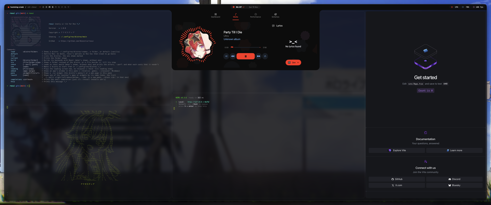

</div>

# Getting started

```sh
gh repo clone Akzestia/rexui
cd rexui
just install
```

```sh
# Run rexui
open -a ~/Applications/Rex\ UI.app
```

```sh
# Load main distro
rexui load main
```

# r/unixporn xD

<div align='center'>

# Main
  
</div>


--------------------

<div align='center'>

# Endfield
  
</div>

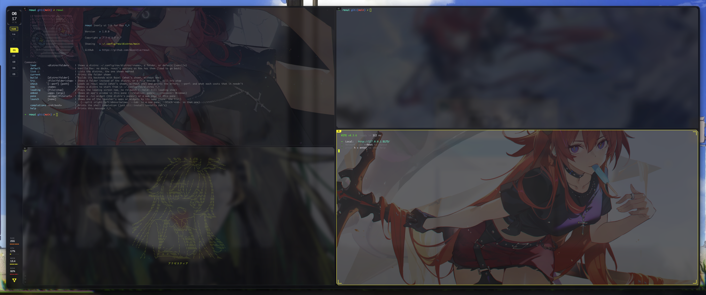


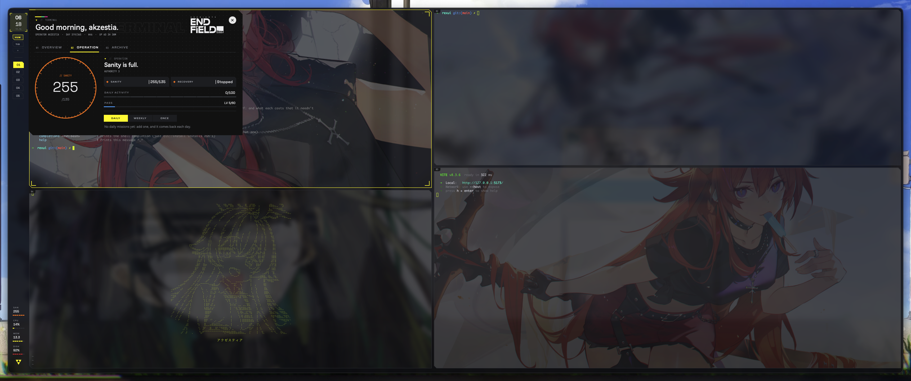


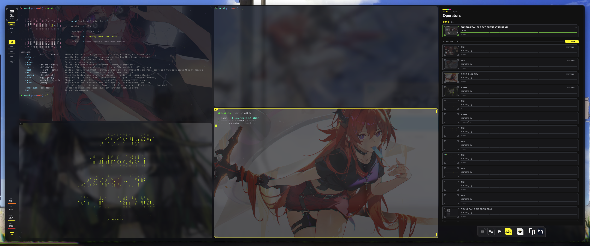

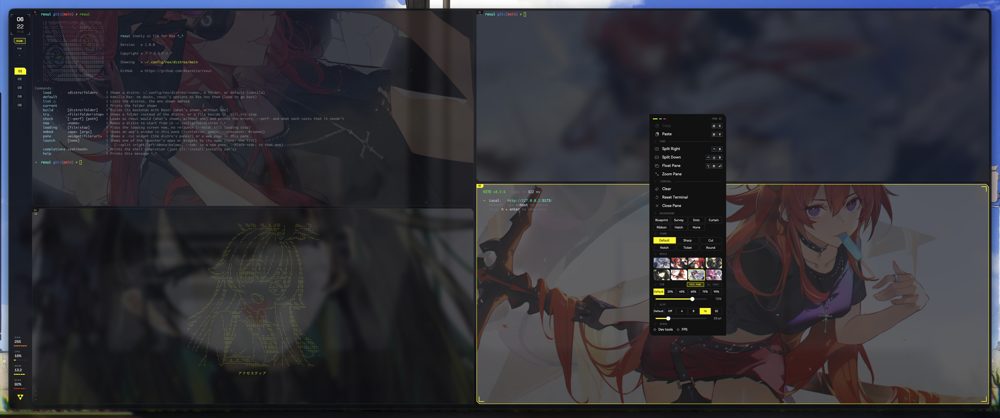

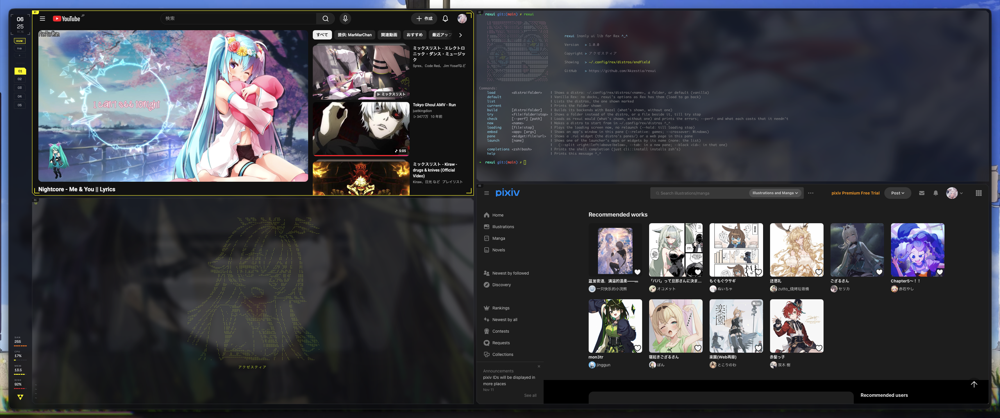


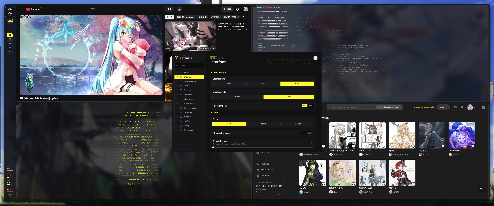

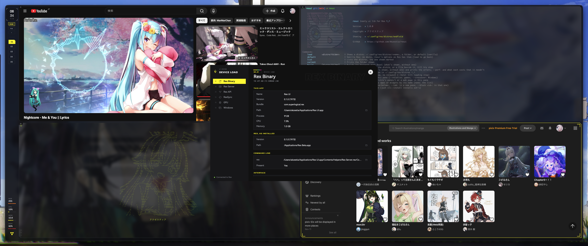

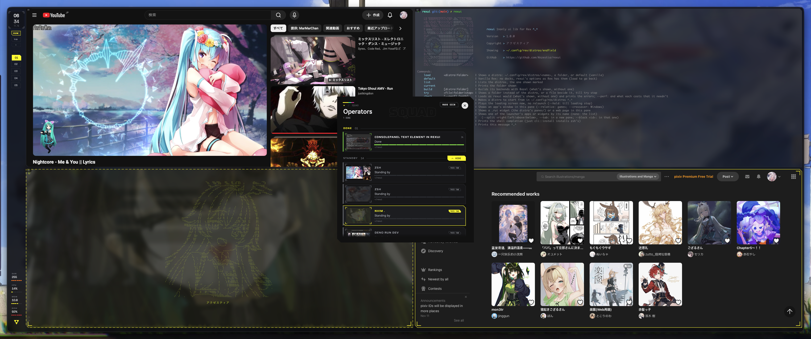


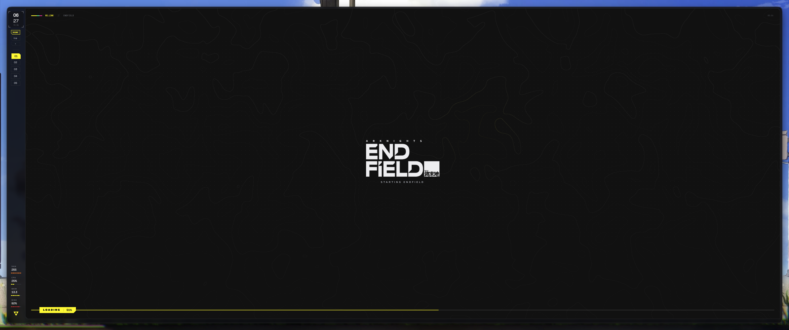


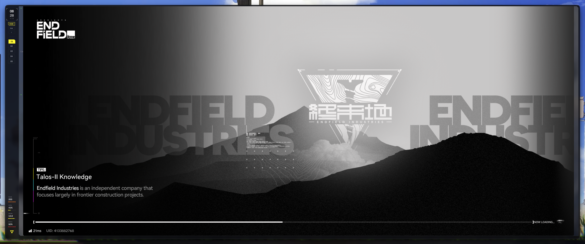


--------------------

<div align='center'>

# Clay (Claude code)

</div>

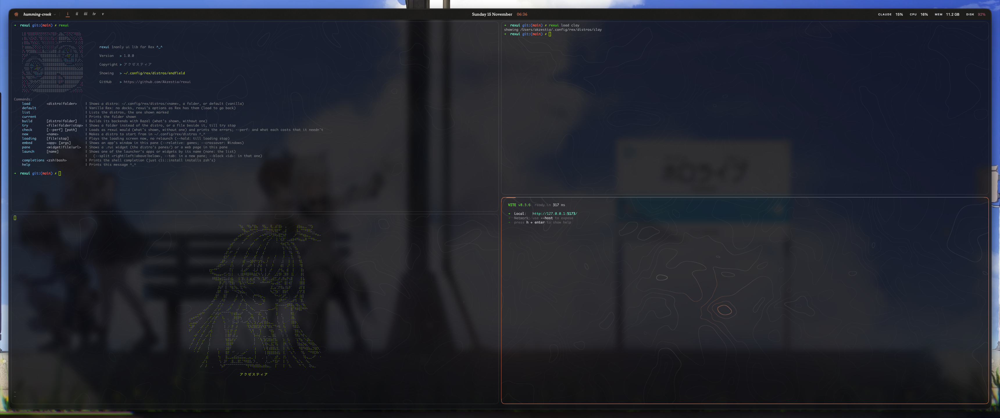


