<div align='center'>

### rexui

A small UI library for Rex ^_^


</div>

# Getting started

```sh
gh repo clone Akzestia/rexui
cd rexui
just install
```

```sh
# Run rexui
open -a ~/Applications/Rex\ UI.app
```

```sh
# Load main distro
rexui load main
```

> [!IMPORTANT]
> Backends have **NO SANDBOX**! Please don't run random code from other repos w/o checking it 1st ty <3

# NeoVim

For highlights ^^

```lua
return {
    dir = "~/rexui/tools/editor/nvim-rui", -- or wherever u have it
    name = "nvim-rui",
    lazy = false,
    dependencies = { "nvim-treesitter/nvim-treesitter" },
}
```

> [!NOTE]
> The language server wasn't handwritten so its kinda meh \~_\~

# r/unixporn xD

<div align='center'>

# Main
  
</div>

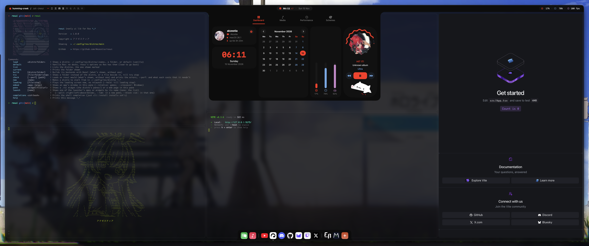

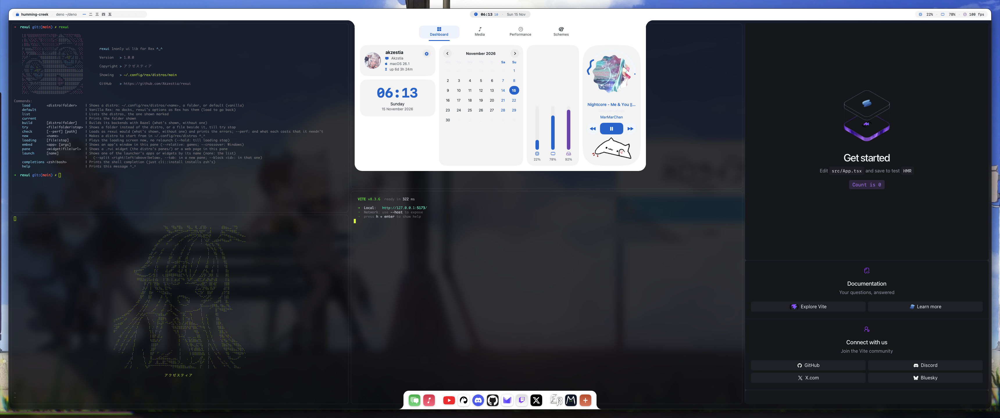

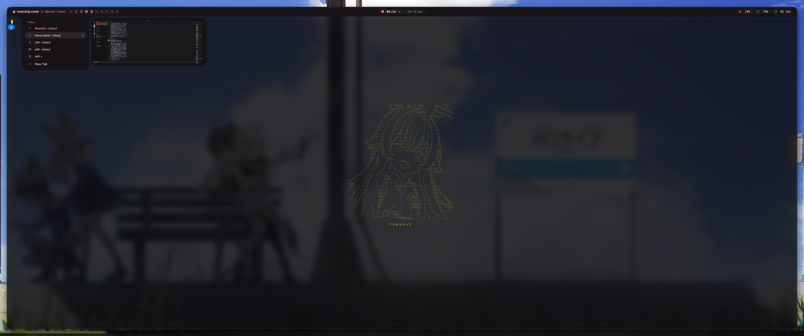

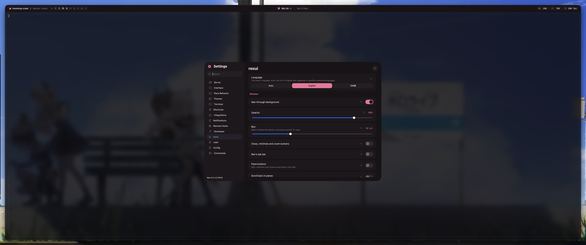

--------------------

<div align='center'>

# Endfield
  
</div>

> [!NOTE]
> Some things in Endfield MAY differ from the demo/screenshots due to DMCA && other "funny" stuff ^_^ 


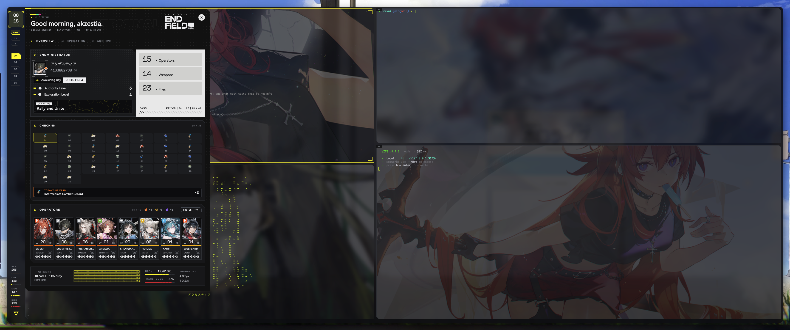


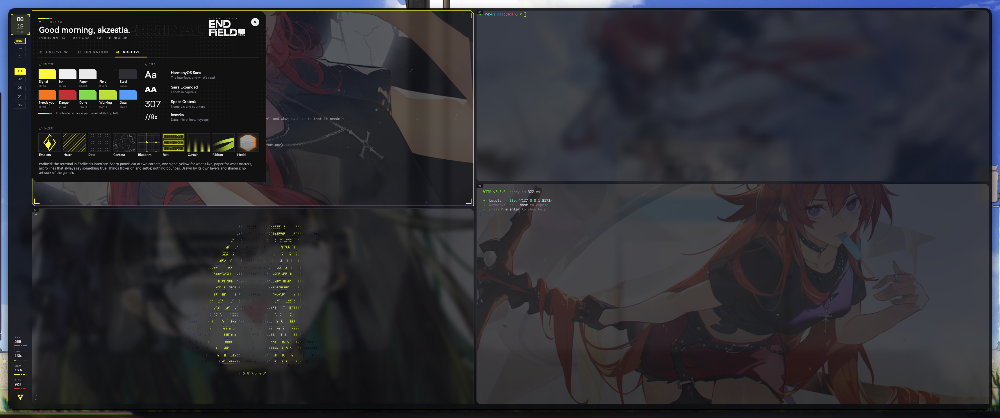

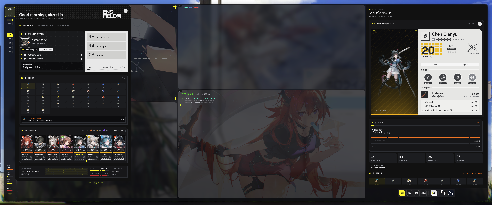

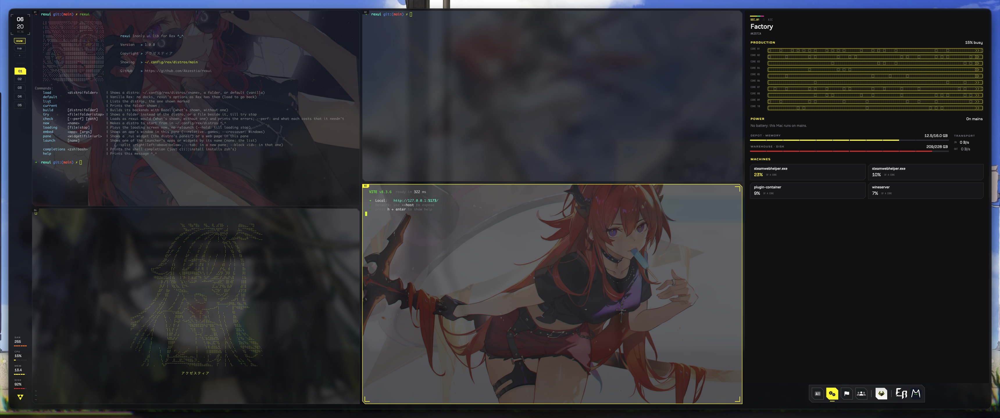


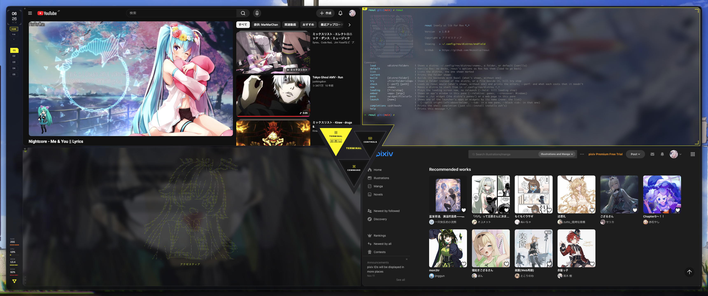


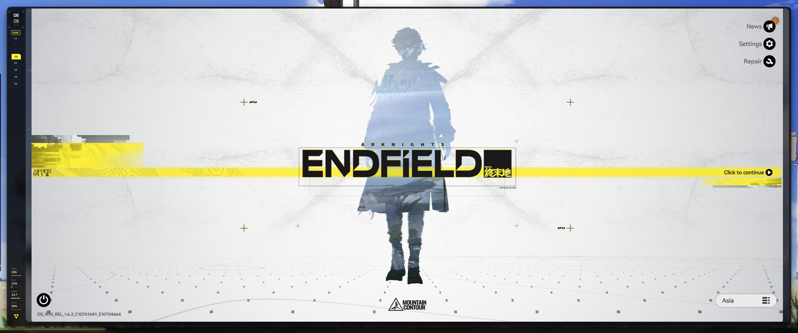


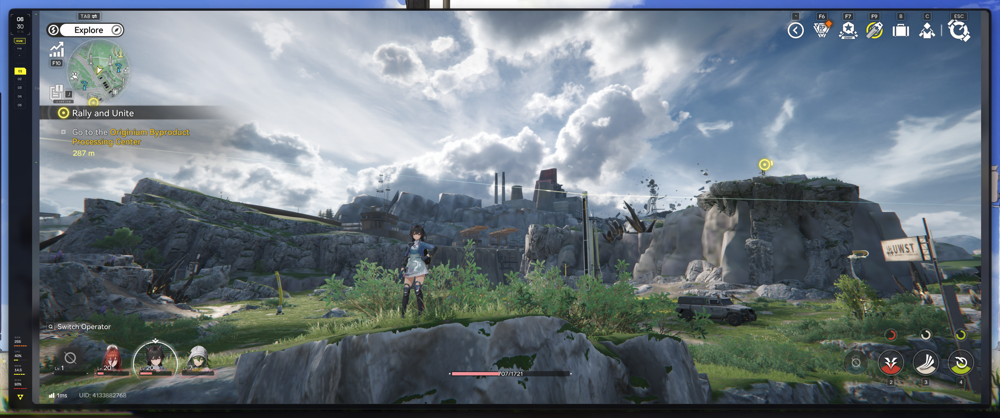

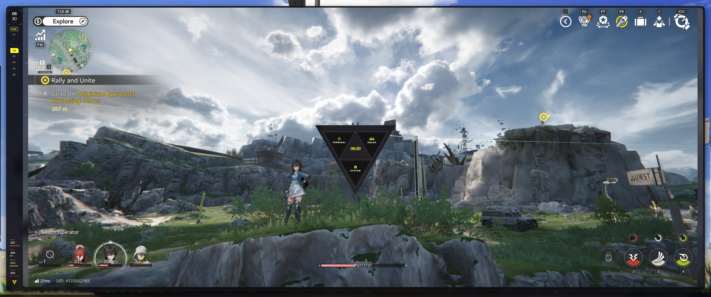

--------------------

<div align='center'>

# Clay (Claude code)

</div>


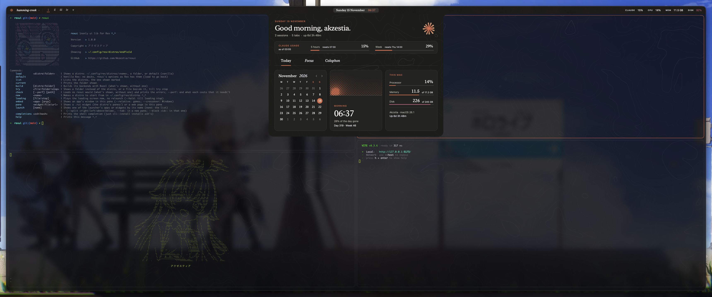

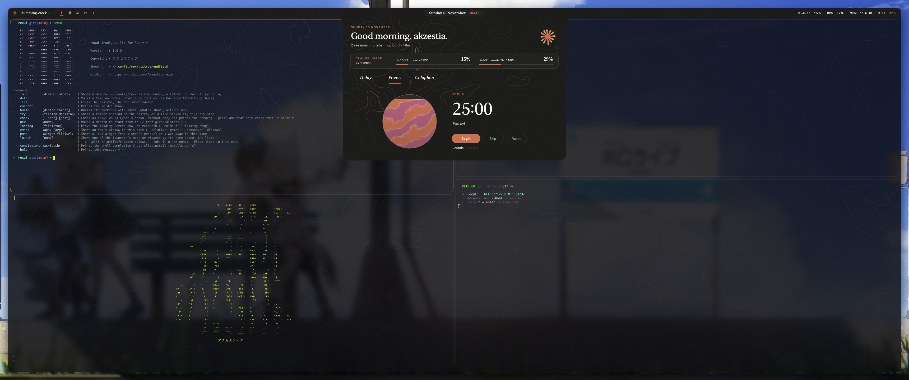

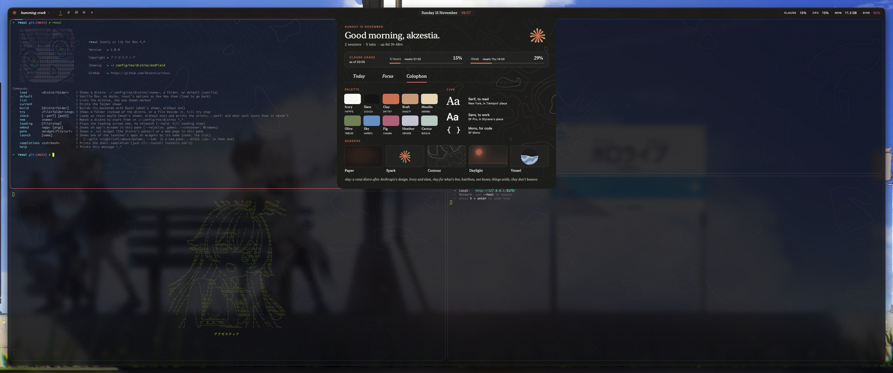

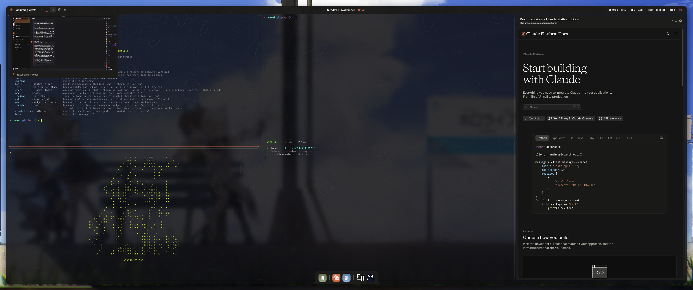

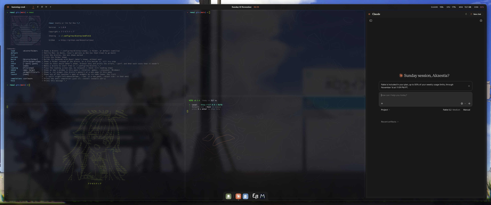
